# Altscape

Alt+Tab for [Omarchy](https://omarchy.org), but you actually see your windows.

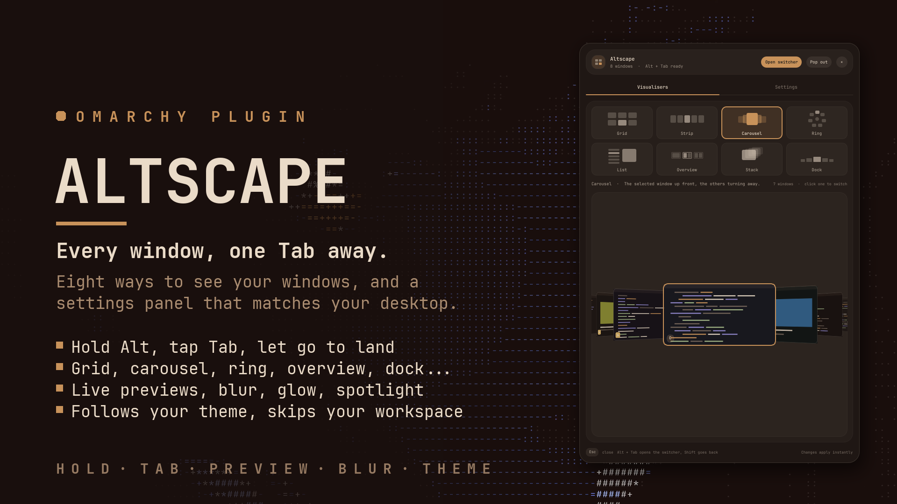

## Why I made this

On Omarchy, Alt+Tab just cycles focus. You press it, something comes to the
front, and you hope it's the window you wanted. With a few browsers, two
terminals and an editor spread over five workspaces, I kept landing on the
wrong one, or worse, on the workspace I was already on.

So I wanted the thing every other desktop has: hold Alt, see everything that's
open, tap Tab until the right one is highlighted, let go. Then I couldn't pick
one way to show the windows, so there are eight.

## What you get

- **Eight layouts**: grid, strip, carousel, ring, list, overview (every
  workspace as a mini screen, windows where they really sit), stack and dock.
  Switch between them in the panel, or press `[` and `]` while the switcher is open.
- **Live previews** of every window at its real size ratio. Nothing else is
  drawn: no panel, no labels, just your windows on top of the desktop. Titles
  can be turned on if you like them.
- **"Other workspaces"** mode, my favourite: it leaves out the workspace you're
  on, so Alt+Tab always takes you somewhere else.
- **Effects** for opening, closing and for the window you move to (grow, lift,
  glow, spotlight, bounce, ...). Every one of them plays as a little preview in
  the settings, so you can try them without guessing.
- **A blurred backdrop** if you want one, see-through or tinted with your theme
  color, with its own strength and opacity.
- **Colors** that follow your Omarchy theme, or your own background/text/accent,
  or monochrome, or a color per app.
- **Web app icons**: Omarchy web apps show their own icon instead of a letter.

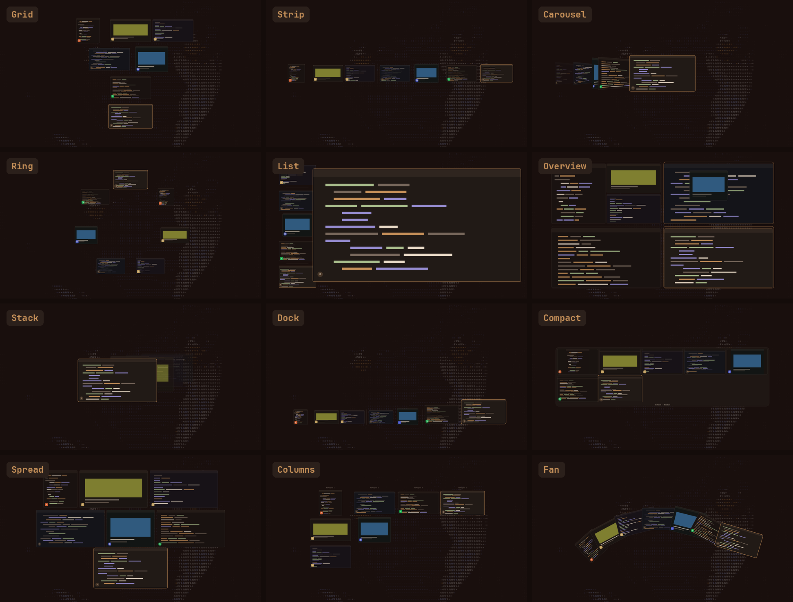

## Install

```bash
omarchy plugin add https://github.com/qempexe/omarchy-altscape.git --enable --yes
omarchy restart shell
```

Then add **Altscape** to your bar (bar settings, or `{"id":"io.github.qempexe.altscape"}`
in `~/.config/omarchy/shell.json`).

That's it. On the first start it sets up Alt+Tab for you (more on that below).

## Using it

Hold **Alt**, tap **Tab**. Keep tapping to move on, **Shift+Tab** to go back,
let go of Alt to switch. The first Tab already lands on the window you used
before, like you'd expect.

While it's open:

| Key | Does |
| --- | --- |
| Arrows, Home, End | move around |
| 1-9 | jump to a workspace |
| Enter / Space / click | switch |
| Delete / middle click | close that window |
| `[` `]` | change layout |
| Esc | cancel |

The bar button: left click opens the panel, right click opens it straight on
Settings, middle click opens the switcher. **Super+Alt+Shift+S** opens the
settings from anywhere (press it again to close them).

## The panel

Two tabs. **Visualisers** is where you pick a layout, with a live preview of
your own windows underneath (you can click one in there to switch to it).
**Settings** has everything else, split into Switcher, Previews, Look, Motion,
Backdrop and Panel. Every change applies right away, and anything you changed
gets a little ↺ to put it back.

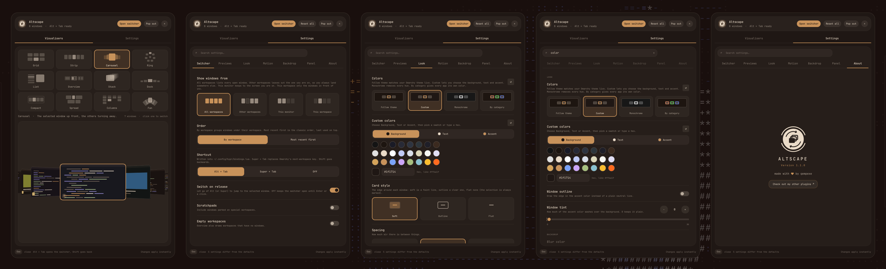

**Visualisers**: pick a layout, the preview underneath is your real windows.

<p align="center">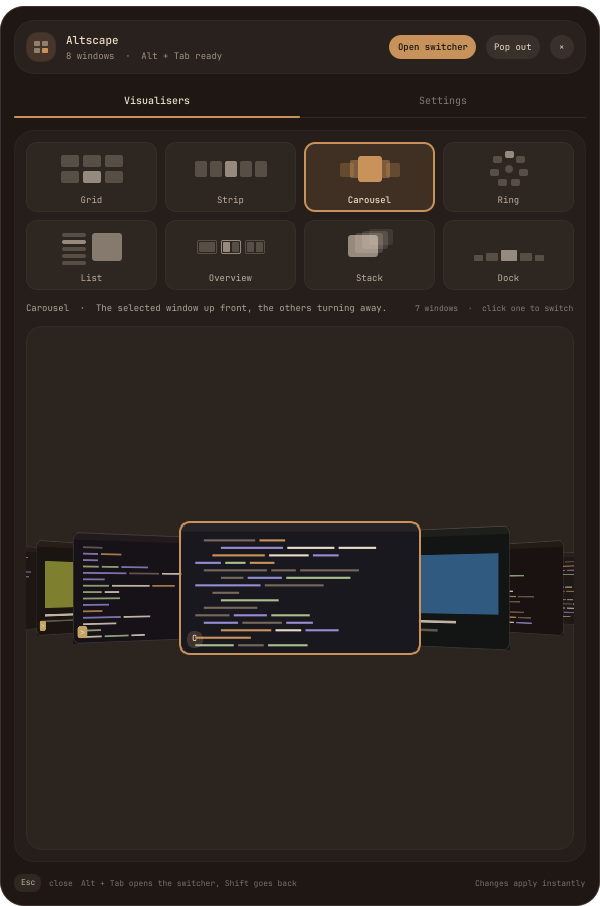</p>

**Switcher**: where the windows come from (all workspaces, other workspaces,
this monitor, this workspace), the order, the shortcut (Alt+Tab, Super+Tab or
off), switch on release, scratchpads and empty workspaces.

<p align="center">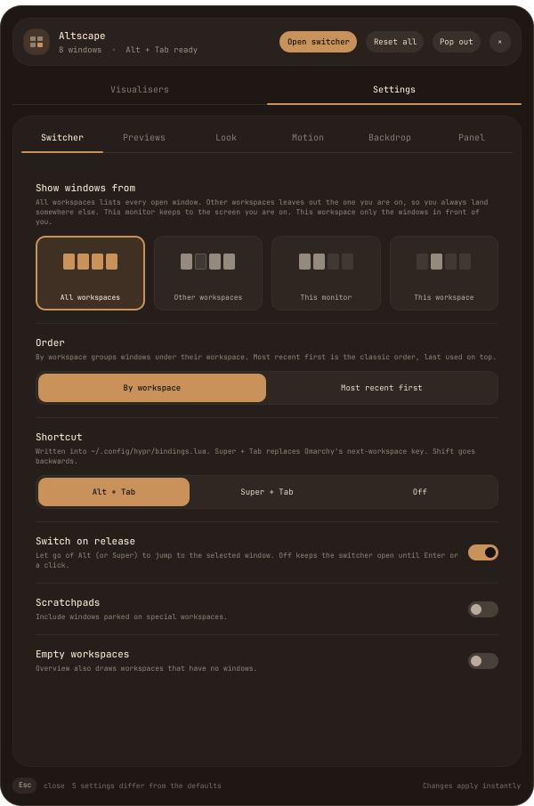</p>

**Previews**: live, snapshot or icons only, how big they are, icon size, titles,
and how a window asking for attention shows it.

<p align="center">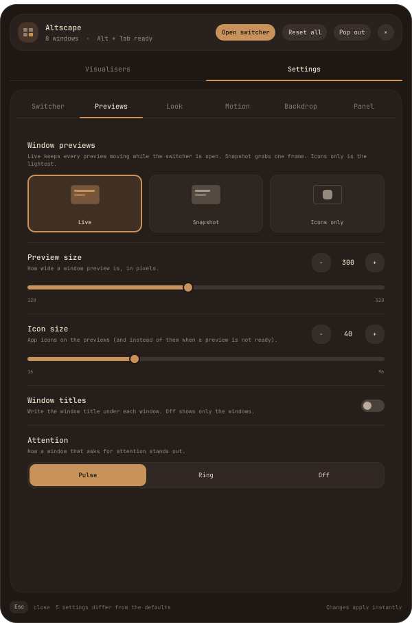</p>

**Look**: colors (theme, custom, monochrome or one per app), the edge around the
windows, spacing, roundness, text size and the panel itself.

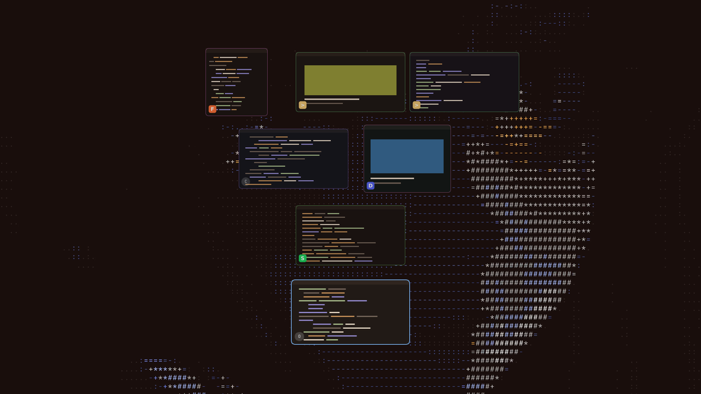

<p align="center">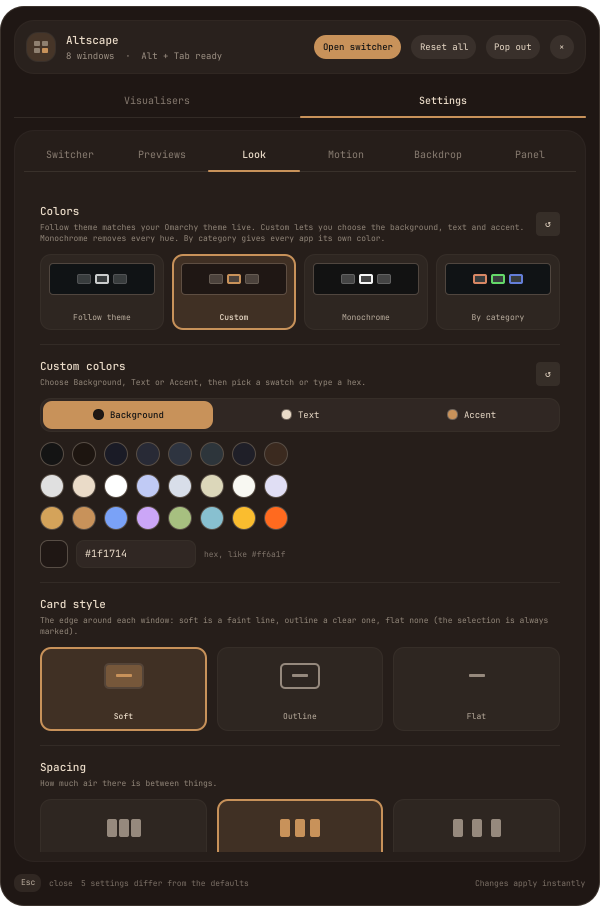</p>

**Motion**: opening, closing and changing-windows effects, and how fast they are.
Spotlight is the one I use.

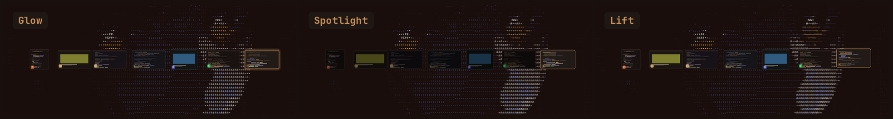

<p align="center">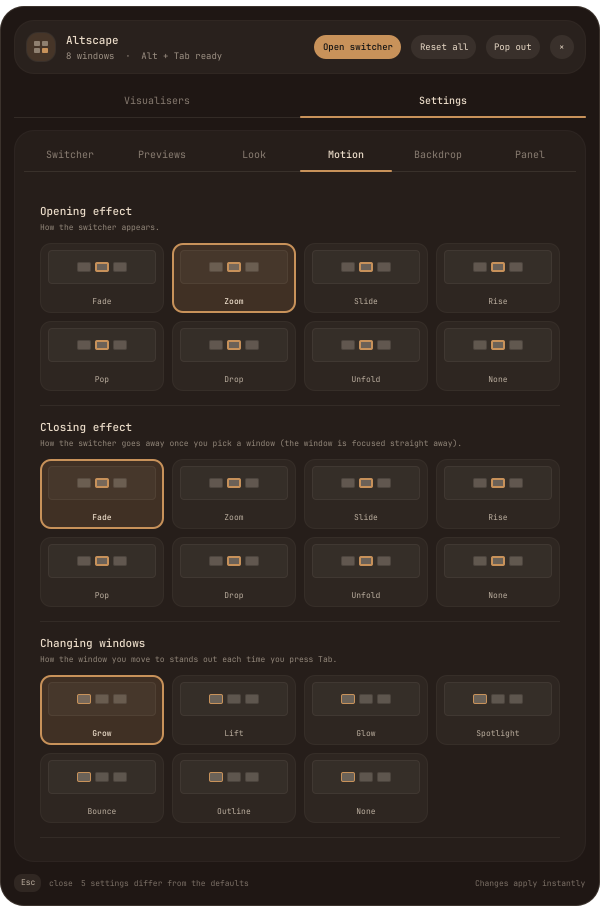</p>

**Backdrop**: clear, darker or blurred. Blur + theme color at around 50% looks
really nice with a dark theme.

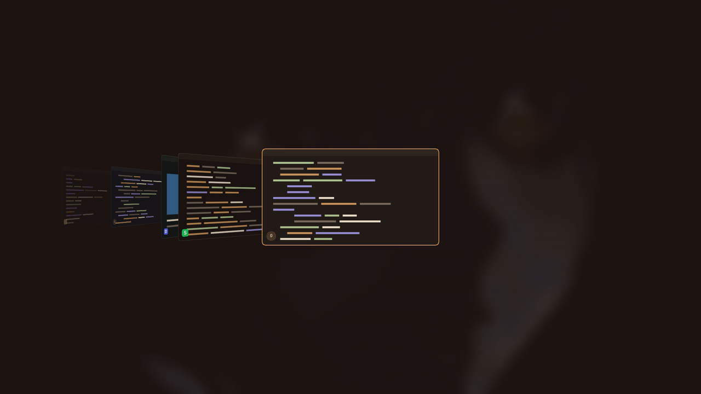

<p align="center">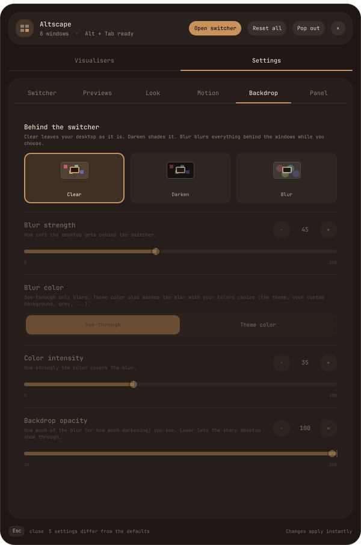</p>

**Panel**: panel size, open it under the bar or as its own window, and what the
bar button shows.

<p align="center">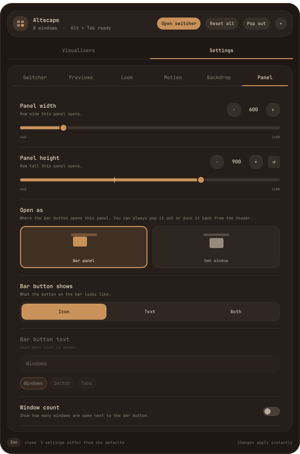</p>

## About the keybind

Altscape writes its own Alt+Tab bind, because doing it by hand every time got old.
It adds one marked block at the end of `~/.config/hypr/hyprland.lua`:

```lua
-- >>> altscape >>>
...
-- <<< altscape <<<
```

It goes at the very end on purpose: some other plugins also grab Alt+Tab, and
whatever is bound last wins. Your file is backed up once as
`hyprland.lua.bak-altscape` before the first change, and Hyprland only reloads
when something actually changed. If the panel header says *Alt + Tab ready*,
it's working.

The same block also adds **Super+Alt+Shift+S** for the settings.

The managed Alt/Super+Tab bindings use Hyprland global shortcuts, so a fast
tap and modifier release reach the switcher in order. Existing IPC commands
remain available for scripts.

If you'd rather manage keybinds yourself, set the shortcut to **Off** and bind
these wherever you want:

```bash
omarchy-shell shell summon io.github.qempexe.altscape next   # the switcher
omarchy-shell io.github.qempexe.altscape settings            # the settings
```

(Classic `hyprland.conf` setups get the same block in `bindings.conf`.)

## Things to know

- It's **Hyprland only**.
- If another plugin uses Alt+Tab too (a layout plugin, for example), Altscape
  takes it over. Switch to Super+Tab if you want to keep the other one.
- Live previews and the blur use some GPU while the switcher is open. On a slow
  machine, set previews to *Snapshot* or *Icons only* and the effects to *Fade*.
- The blur is a snapshot of the screen when the switcher opens, so a video
  playing behind it won't move.
- No search. You pick by moving, not by typing.

## Where things are

- Settings: `~/.local/state/omarchy-altscape/settings.json`
- The keybind block: the end of `~/.config/hypr/hyprland.lua`
- Nothing else is written. No network, and screen captures are never saved.

For poking at it from a terminal:

```bash
omarchy-shell io.github.qempexe.altscape status
omarchy-shell io.github.qempexe.altscape mode ring
omarchy-shell io.github.qempexe.altscape settings   # or panel, both toggle
```

## Updating

```bash
omarchy plugin update io.github.qempexe.altscape
omarchy restart shell
```

The restart matters, the shell keeps the old version loaded otherwise.

## Uninstall

Remove the keybind first, then the plugin:

```bash
~/.config/omarchy/plugins/io.github.qempexe.altscape/bin/altscape-binds remove
omarchy plugin remove io.github.qempexe.altscape
omarchy restart shell
rm -rf ~/.local/state/omarchy-altscape   # only if you want your settings gone too
```

If you remove the plugin first, nothing breaks: the block just stops doing
anything and Omarchy's normal Alt+Tab comes back. You can delete the block later.

## License

[MIT](LICENSE)
