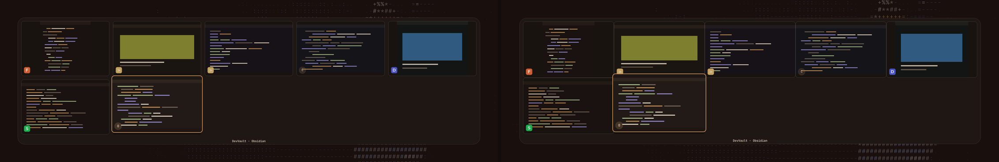

<p align="center">
  <picture>
    <source media="(prefers-color-scheme: light)" srcset="assets/logo-dark.png">
    
  </picture>
</p>

<h1 align="center">Altscape</h1>

<p align="center">Alt+Tab for <a href="https://omarchy.org">Omarchy</a>, but you actually see your windows.</p>


On Omarchy, Alt+Tab just cycles focus. You press it, something comes to the front, and
you hope it's the window you wanted. With a few browsers, two terminals and an editor
spread over five workspaces, I kept landing on the wrong one, or on the workspace I was
already on. So Altscape does what every other desktop does: hold Alt, see everything
that's open, tap Tab until the right one is highlighted, let go. Then I couldn't pick
one way to show the windows, so there are twelve.

## Features

- **Twelve layouts**: grid, strip, carousel, ring, list, overview (every workspace as a
  mini screen, windows where they really sit), stack, dock, compact, spread, columns and
  fan. Switch in the panel, or with `[` and `]` while the switcher is open.
- **Live previews** of every window at its real shape, or the same size for all of
  them, as close together as you like.
- **"Other workspaces"**, my favourite: it leaves out the workspace you're on, so
  Alt+Tab always takes you somewhere else.
- **Effects** for opening, closing and the window you move to (grow, lift, glow,
  spotlight, bounce, ...). Each one plays as a small preview in the settings.
- **A blurred backdrop** if you want one, see-through or tinted with your theme color.
- **Colors** that follow your Omarchy theme, or your own, or monochrome, or one per app.
- **Web app icons**: Omarchy web apps show their own icon instead of a letter.
- **Sets up Alt+Tab itself**, and checks that Hyprland really uses it.

### Layouts


**Compact** is the one that looks like Windows and macOS: every window the same size,
close together in one panel, the title of the selected one underneath. It makes the
previews smaller until everything fits. **Space between windows** sets the gap here and
in the other layouts, down to none at all.

**Spread** fills the screen like Mission Control, every window at its own shape.
**Columns** gives each workspace a column with its name on top, and **Fan** holds the
windows like a hand of cards.



### Effects, colors and backdrop

Spotlight is the one I use. Blur with the theme color at around 50% looks really nice
with a dark theme, and **By category** gives every app its own color.


## Installation

```bash
omarchy plugin add https://github.com/qempexe/omarchy-altscape.git --enable --yes
omarchy restart shell
```

Then add **Altscape** to your bar, from the bar settings or with
`{ "id": "io.github.qempexe.altscape" }` under `bar` → `layout` in
`~/.config/omarchy/shell.json`.

On the first start it sets up Alt+Tab for you (see **The keybind** below). It needs
Hyprland; everything else comes with Omarchy.

## Usage

Hold **Alt**, tap **Tab**. Keep tapping to move on, **Shift+Tab** to go back, let go of
Alt to switch. The first Tab already lands on the window you used before.

| Key | Does |
| --- | --- |
| Arrows, Home, End | move around |
| 1-9 | jump to a workspace |
| Enter / Space / click | switch |
| Delete / middle click | close that window |
| `[` `]` | change layout |
| Esc | cancel |

### Bar button

| Click | Does |
| --- | --- |
| Left | opens the panel |
| Right | opens it on Settings |
| Middle | opens the switcher (or nothing, see **Middle click**) |

**Super+Alt+Shift+S** opens the settings from anywhere, and closes them again.

### The keybind

Altscape writes its own Alt+Tab bind, in one marked block at the end of
`~/.config/hypr/hyprland.lua`:

```lua
-- >>> altscape >>>
...
-- <<< altscape <<<
```

It goes at the very end on purpose: some other plugins also grab Alt+Tab, and whatever
is bound last wins. Your file is backed up once as `hyprland.lua.bak-altscape` before
the first change, and Hyprland only reloads when something changed. If the panel header
says *Alt + Tab ready*, it's working.

The block uses Hyprland global shortcuts, so a fast tap and the release of Alt reach
the switcher in order. It also adds **Super+Alt+Shift+S** for the settings, and turns
off Hyprland's own animation for the switcher's layer, so only Altscape's effects play.
Classic `hyprland.conf` setups get the same block in `bindings.conf`.

To manage keybinds yourself, set **Shortcut** to **Off** and bind these:

```bash
omarchy-shell shell summon io.github.qempexe.altscape next   # the switcher
omarchy-shell io.github.qempexe.altscape settings            # the settings
```

## Configuration

The **Settings** tab, or a right click on the bar button. Everything applies at once and
is saved in `~/.local/state/omarchy-altscape/settings.json`.


**Visualisers** is where you pick a layout, with a live preview of your own windows
underneath (click one in there to switch to it). **Settings** has the rest in tabs, with
a search box above them that looks through every tab. Each changed row gets a **↺** to
put it back, and **Reset all** in the header puts back everything but the layout.

| Tab | Setting | Default | |
| --- | --- | --- | --- |
| Switcher | Show windows from | All workspaces | or Other workspaces, This monitor, This workspace |
| | Order | By workspace | or Most recent first |
| | Shortcut | Alt + Tab | or Super + Tab, or Off |
| | Switch on release | on | off keeps it open until you press Enter |
| | Scratchpads, Empty workspaces | off | |
| Previews | Window previews | Live | or Snapshot, or Icons only |
| | Preview size | 300 | 120 to 520 pixels wide |
| | Space between windows | 12 | 0 to 48 pixels |
| | Same size for every window | off | each preview at its window's own shape |
| | Icon size | 40 | 16 to 96 |
| | Window titles | off | |
| | Attention | Pulse | or Ring, or Off |
| Look | Colors | Follow theme | or Custom, Monochrome, By category |
| | Card style | Soft | or Outline, Flat |
| | Spacing | Comfortable | or Compact, Spacious |
| | Roundness | 6 | 0 to 20 |
| | Window outline | off | the accent around the panel |
| | Text size | 100 | 80 to 150 % |
| | Window tint, Opacity | 0, 96 | |
| Motion | Opening effect | Zoom | Fade, Zoom, Slide, Rise, Pop, Drop, Unfold or None |
| | Closing effect | Fade | the same |
| | Changing windows | Grow | Grow, Lift, Glow, Spotlight, Bounce, Outline or None |
| | Speed | 140 | 40 to 600 ms |
| Backdrop | Behind the switcher | Clear | or Darken, Blur |
| | Blur strength, Blur color, Color intensity, Backdrop opacity | | |
| Panel | Panel width, height | 600 × 680 | |
| | Open as | Bar panel | or Own window |
| | Bar button shows | Icon | or Text, or Both, with your own text and the window count |
| | Middle click | Open the switcher | or Nothing |

**About**, the last tab, has the logo, the version and a link to more plugins.

For scripts:

```bash
omarchy-shell io.github.qempexe.altscape status
omarchy-shell io.github.qempexe.altscape mode compact
omarchy-shell io.github.qempexe.altscape settings   # or panel, both toggle
```

## Troubleshooting

- **Alt+Tab does Omarchy's old thing.** Check the panel header. *Shortcut written, but
  Hyprland is not using it* means another config file binds Alt+Tab after Altscape's
  block; `~/.local/state/omarchy-altscape/binds-check.txt` shows what Hyprland reported.
  A layout plugin that also uses Alt+Tab wins if it loads later: switch Altscape to
  **Super+Tab** to keep both.
- **Changes don't show up after an update.** Run `omarchy restart shell`; the shell
  keeps the old version loaded otherwise.
- **It feels heavy.** Live previews and the blur use some GPU while the switcher is
  open. Set previews to *Snapshot* or *Icons only*, and the effects to *Fade*.
- **The blur doesn't move.** It is a snapshot of the screen when the switcher opens, so
  a video behind it stands still.
- **No search in the switcher.** You pick by moving, not by typing.
- **Where things live.**

  | Path | Contents |
  | --- | --- |
  | `~/.local/state/omarchy-altscape/settings.json` | your settings |
  | the end of `~/.config/hypr/hyprland.lua` | the keybind block |
  | `~/.config/hypr/hyprland.lua.bak-altscape` | your file before the first change |

  Nothing else is written. No network, and screen captures are never saved.

## Contributing

Bug reports and ideas are welcome as [issues](https://github.com/qempexe/omarchy-altscape/issues).
[CONTRIBUTING.md](CONTRIBUTING.md) explains how to add a setting or a layout, the rules
and the tests. Everyone taking part is expected to follow the
[code of conduct](CODE_OF_CONDUCT.md). What changed in each version is in the
[changelog](CHANGELOG.md).

### Source layout

```
qml/
├── Service.qml       the windows from Hyprland, focusing, settings, ipc
├── Switcher.qml      the overlay: opening, closing, keys, effects, backdrop
├── BarWidget.qml     the bar button
├── core/             SwitchState (selection), FocusRequest (focus and raise),
│                     SwitcherShortcuts, SettingsStore, UiState
├── switcher/         SwitchView, one Viz*.qml per layout, WindowCard, AppIcon
├── panel/            Panel, PopoutWindow, PanelView, VisualisersView, SettingsView +
│                     SettingRow + TileArt + ModeArt, AboutPage
├── controls/         Btn, Chip, Sw, TextBox, Txt
└── js/               Schema.js (settings and layouts), Model.js (windows and order),
                      Effects.js
bin/altscape-binds    writes, checks and removes the keybind block
assets/               the logo, light and dark
tests/                Qt tests, binding tests, live shortcut tests
```

### Upgrading and uninstalling

```bash
omarchy plugin update io.github.qempexe.altscape
omarchy restart shell
```

Remove the keybind first, then the plugin:

```bash
~/.config/omarchy/plugins/io.github.qempexe.altscape/bin/altscape-binds remove
omarchy plugin remove io.github.qempexe.altscape
omarchy restart shell
rm -rf ~/.local/state/omarchy-altscape   # settings
```

If you remove the plugin first, nothing breaks: the block stops doing anything and
Omarchy's normal Alt+Tab comes back. You can delete the block later.

## License and credits

[MIT](LICENSE).

- Thanks to rugobal for the global shortcuts, the focus and raise fixes and the tests,
  to PeterHennesey for the closing flicker report and the layer rule, and to rodrigoGA
  for the idea behind Compact.
- Thanks to the **Omarchy** project for the shell and its plugin system, to
  **Hyprland**, and to **Quickshell** and **Qt** for the toolkit.
- Thanks to everyone who tests it and reports issues.

Altscape is an independent community plugin. It is not affiliated with or endorsed by
Omarchy or Hyprland.
